# robbR: Risk of Bias Plots for Meta-Analyses in R

## Overview

robbR is an R package for creating publication-ready risk of bias plots
for systematic reviews and meta-analyses. It produces traffic-light
tables of domain-level judgements and weighted summary bar plots, for a
wide range of risk of bias and quality assessment tools.

## Key Features

- **Traffic-Light Plots**: Domain-level judgements for each study,
  displayed as icons in a clean table
- **Weighted Summary Plots**: Stacked bar plots of the proportion of
  studies (or meta-analytic weight) at each judgement
- **Multiple Tools**: RoB 2 (including cluster-randomised and crossover
  variants), ROBINS-I V2, ROBINS-E, QUADAS-2, CLARITY, RoB NMA, PROBAST
  and PROBAST+AI
- **Automatic Overall Judgements**: Overall risk of bias is derived from
  the domains when not supplied
- **Flexible Input**: Judgements such as “low”, “Low risk” and “low risk
  of bias” are standardised automatically
- **Subgroup Analysis**: Group studies by outcome, design or analysis
- **Tool-Specific Legends**: Legends list only the domains and
  judgements present in the plot
- **Extensive Customisation**: Fonts, titles, sorting and layout

## Supported Tools

| `rob_tool` | Tool | Domain columns | Overall columns |
|----|----|----|----|
| `"rob2"` | RoB 2 | D1, (D1b), D2–D5, (DS) | Overall |
| `"robins_i"` | ROBINS-I V2 | D1–D6 | Overall |
| `"robins_e"` | ROBINS-E | D1–D7 | Overall |
| `"quadas2"` | QUADAS-2 | D1–D4 | Overall |
| `"clarity"` | CLARITY | D1–D10, (D11), (D12) | None |
| `"rob_nma"` | RoB NMA (with ROBIS domains 1–3) | (R1–R3), D1–D3 | Results, Conclusions |
| `"probast"` | PROBAST | D1–D4, (A1–A3) | Overall, Applicability |
| `"probast_ai"` | PROBAST+AI | D1–D4, (A1–A3) | Overall, Applicability |

Columns in brackets are optional. Missing judgements (`NA`) are shown as
“Not applicable”.

## Installation

You can install the development version of robbR from GitHub:

``` r

# install.packages("devtools")
devtools::install_github("BLMoran/robbR")
```

## Basic Usage

robbR expects one row per study, with columns for the study label
(`Author`), year (`Year`) and each domain (`D1`, `D2`, …). Example
datasets are included for every tool (see
[`?rob_datasets`](https://blmoran.github.io/robbR/reference/rob_datasets.md)).

``` r

library(robbR)

rob2_data
```

### Risk of Bias Plot

``` r

rob_plot(rob2_data)
```

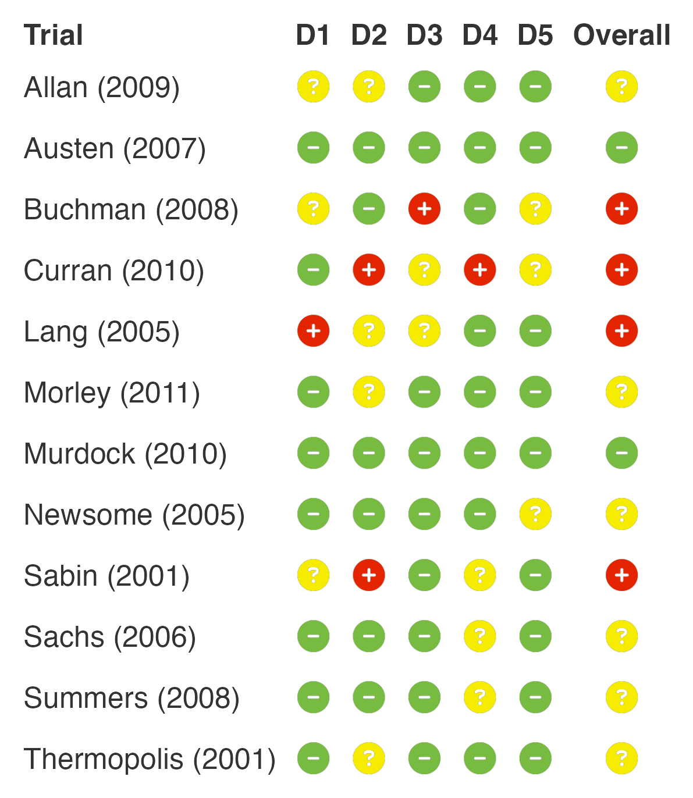

### Add Risk of Bias Legend

``` r

rob_plot(rob2_data, add_rob_legend = TRUE)
```

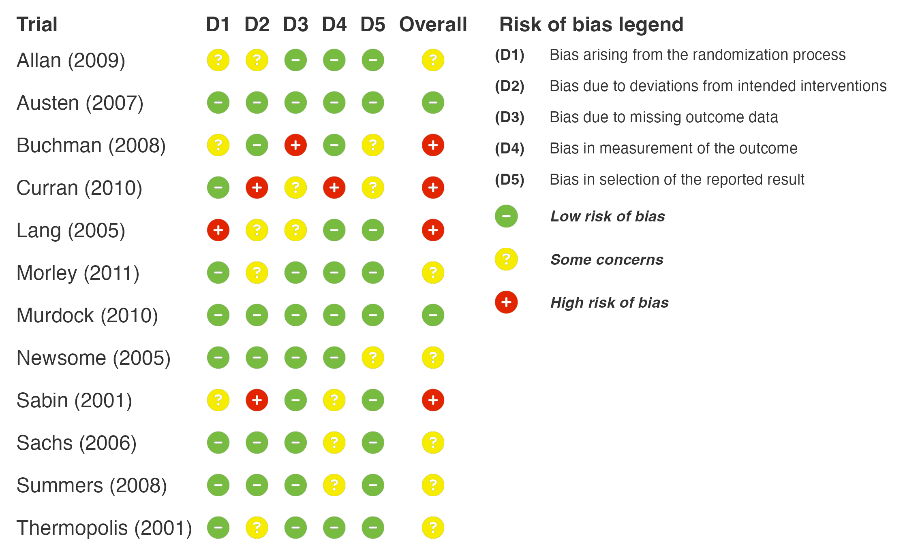

### Hide the Overall Column

``` r

rob_plot(rob2_data, show_overall = FALSE, add_rob_legend = TRUE)
```

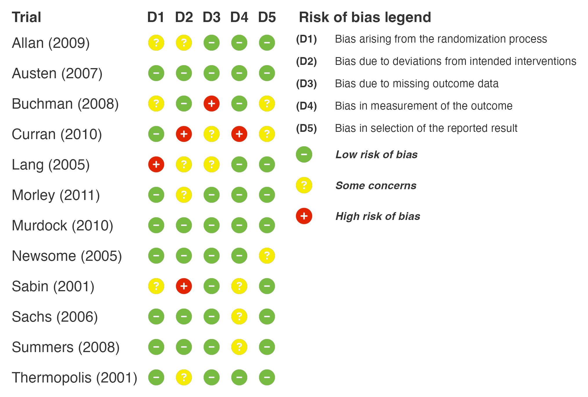

### Add Subgroups

``` r

rob_plot(
  data = rob2_data,
  subgroup = TRUE,
  sort_subgroup_by = c("Comedy", "Drama"),
  add_rob_legend = TRUE
)
```

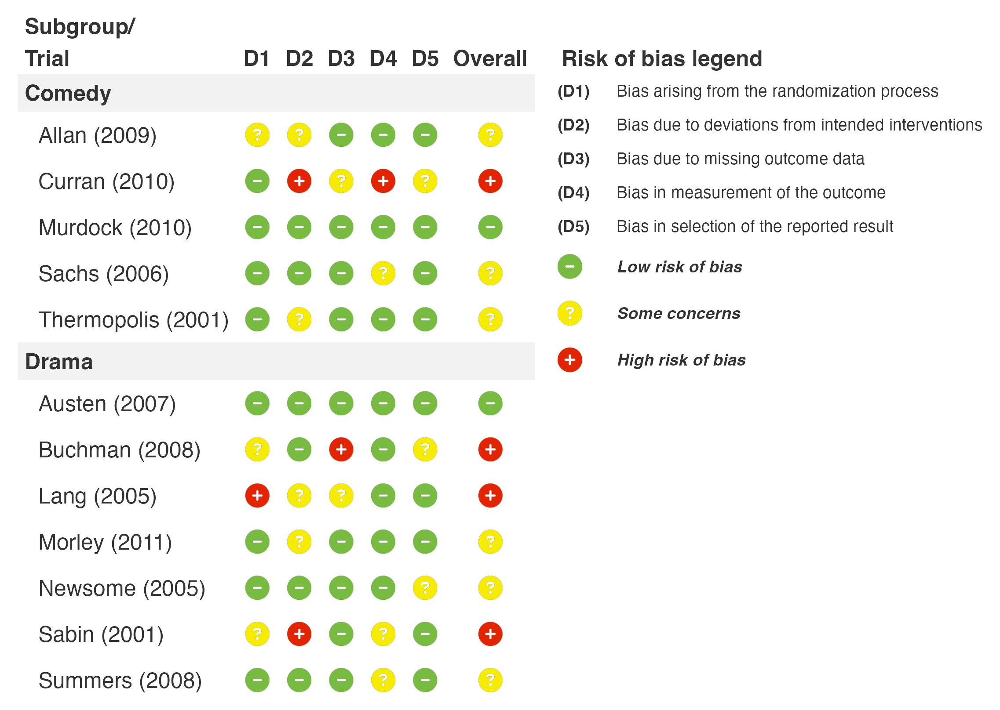

### RoB 2 Algorithm (Parallel, Cluster and Crossover Trials)

Enter the answers to the signalling questions and
[`rob2_algorithm()`](https://blmoran.github.io/robbR/reference/rob2_algorithm.md)
applies the RoB 2 algorithms to give the domain and overall judgements.

``` r

rob2_sq_data |>
  rob2_algorithm(design = design) |>
  rob_plot(add_rob_legend = TRUE)
```

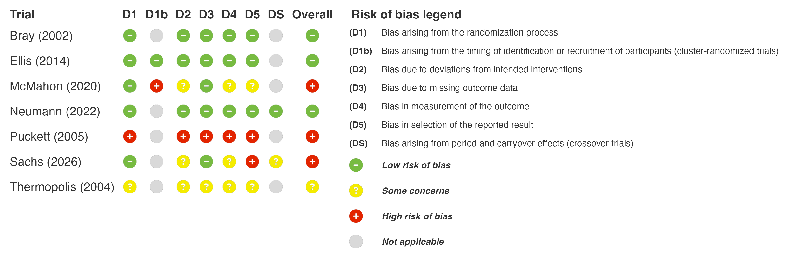

### CLARITY

``` r

rob_plot(clarity_data, rob_tool = "clarity", add_rob_legend = TRUE)
```

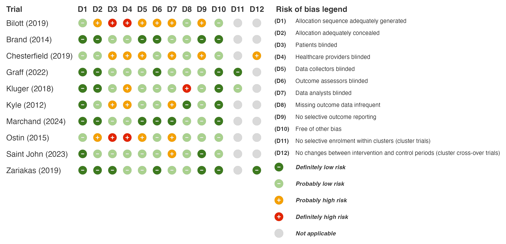

### ROBINS-I

``` r

rob_plot(robins_i_data, rob_tool = "robins_i", add_rob_legend = TRUE)
```

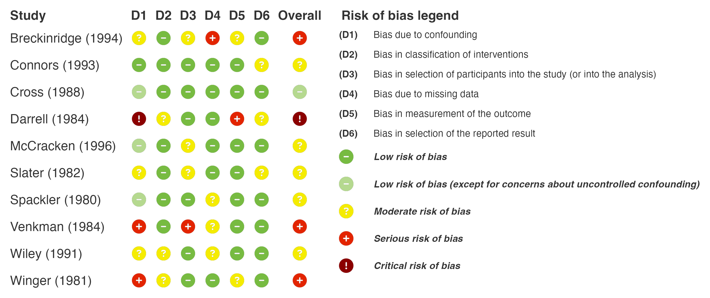

### ROBINS-E

``` r

rob_plot(robins_e_data, rob_tool = "robins_e", add_rob_legend = TRUE)
```

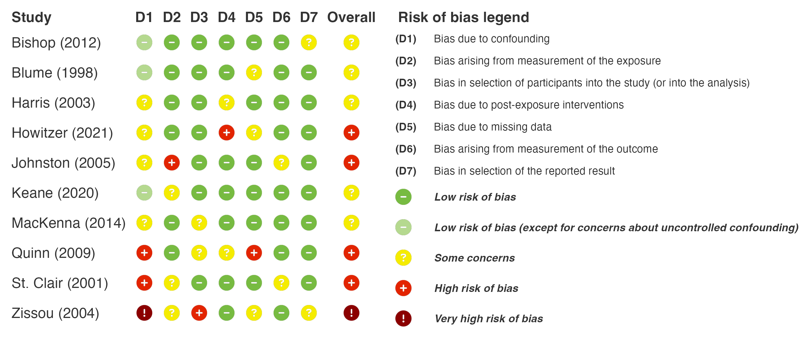

### QUADAS-2

``` r

rob_plot(quadas2_data, rob_tool = "quadas2", add_rob_legend = TRUE)
```

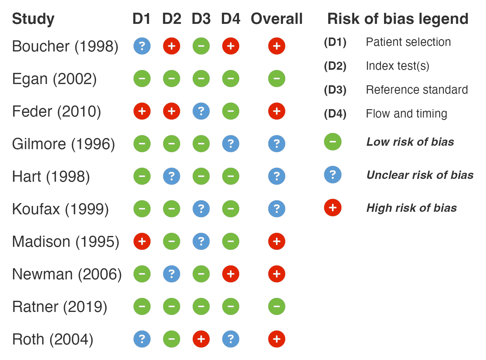

### RoB NMA

``` r

rob_plot(rob_nma_data, rob_tool = "rob_nma", add_rob_legend = TRUE)
```

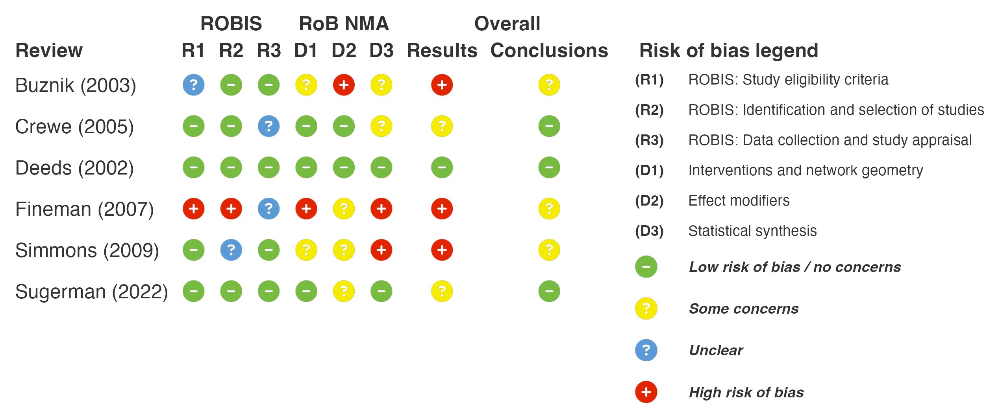

### PROBAST

``` r

rob_plot(probast_data, rob_tool = "probast", add_rob_legend = TRUE)
```

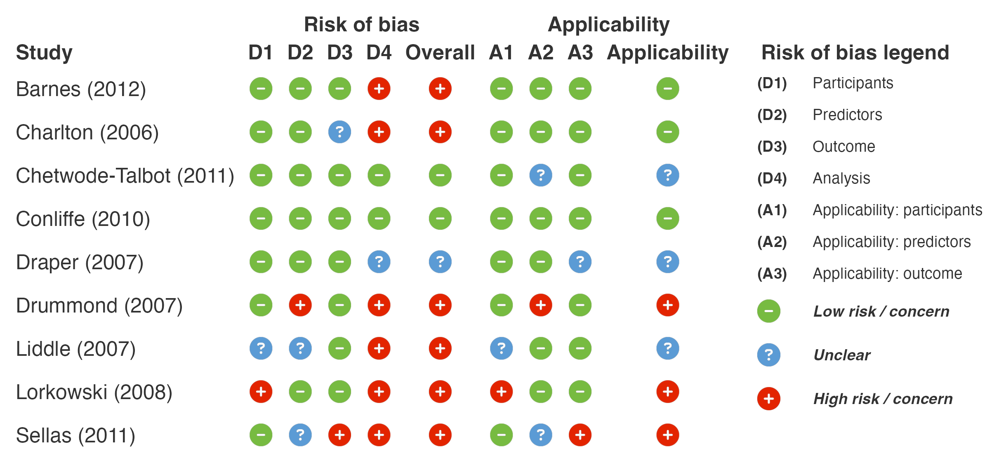

### PROBAST+AI

``` r

rob_plot(
  data = probast_ai_data,
  rob_tool = "probast_ai",
  subgroup = TRUE,
  sort_subgroup_by = c("Development", "Evaluation"),
  add_rob_legend = TRUE
)
```

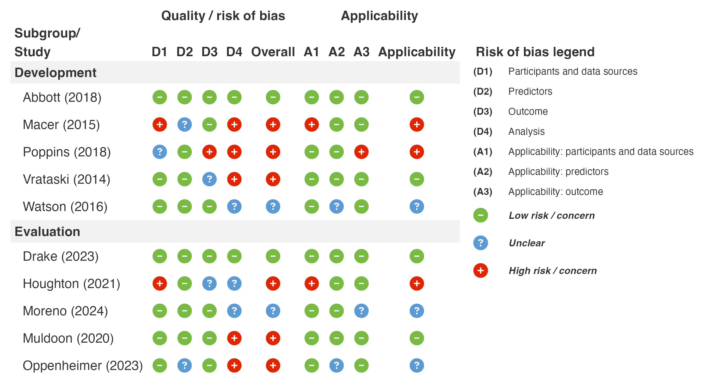

### Summary Plot

``` r

rob_summary(rob2_data)
```

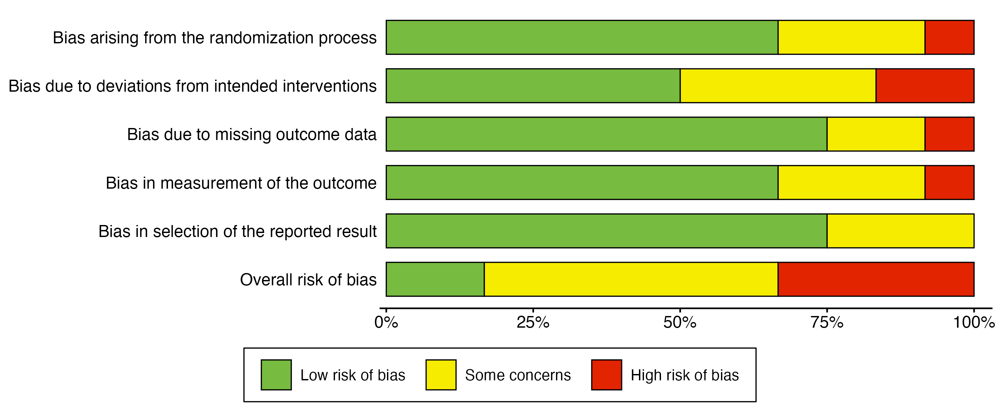

### Weighted Summary Plot

``` r

rob_summary(
  data = rob2_data,
  weight = weight,
  title = "Risk of bias weighted by study weight"
)
```

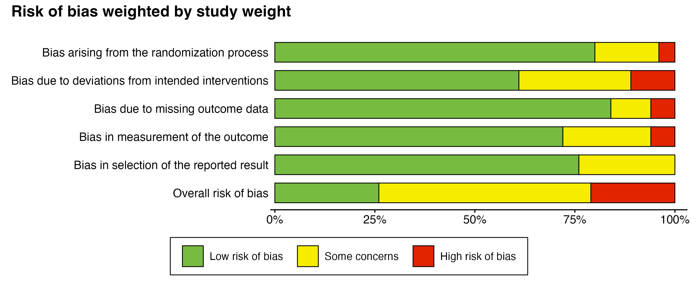

### Weighted Summary Plot (ROBINS-I)

``` r

rob_summary(robins_i_data, weight = weight, rob_tool = "robins_i")
```

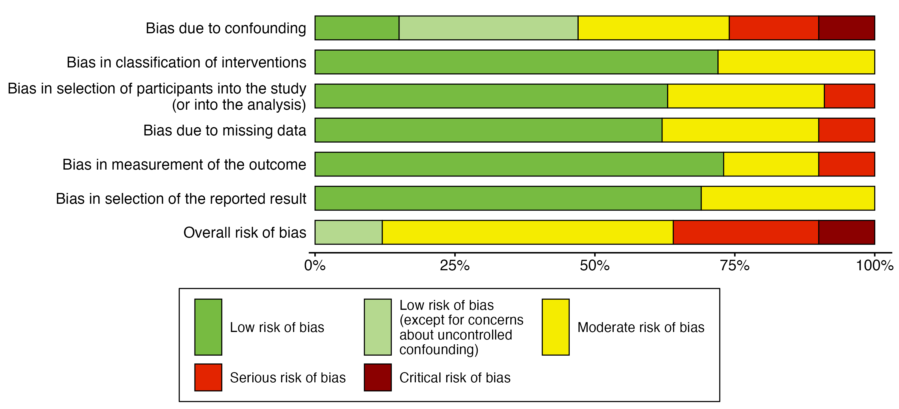

## Citation

If you use robbR in your research, please cite:

``` R
@Manual{,
  title = {robbR: Risk of Bias Plots for Meta-Analyses in R},
  author = {[Benjamin Moran]},
  year = {2026},
  note = {R package version 0.0.0.9000},
  url = {https://github.com/BLMoran/robbR},
}
```

Please also cite the risk of bias tool used in your review.

## Dependencies

robbR depends on several R packages:

- [gt](https://gt.rstudio.com) for creating tables
- [patchwork](https://patchwork.data-imaginist.com) for combining tables
  and legends
- [ggplot2](https://ggplot2.tidyverse.org) for plotting
- [fontawesome](https://rstudio.github.io/fontawesome/) for risk of bias
  icons
- [dplyr](https://dplyr.tidyverse.org),
  [tidyr](https://tidyr.tidyverse.org),
  [purrr](https://purrr.tidyverse.org),
  [stringr](https://stringr.tidyverse.org) and
  [forcats](https://forcats.tidyverse.org) for data manipulation
- [cli](https://cli.r-lib.org) and [rlang](https://rlang.r-lib.org) for
  messages and tidy evaluation

## Related Packages

- [bayesfoRest](https://github.com/BLMoran/bayesfoRest) for forest plots
  from Bayesian meta-analyses, with integrated risk of bias columns

## Feedback, Issues and Contributing

We welcome feedback, suggestions, issues and contributions. Please feel
free to contact [Ben](mailto:ben.moran@newcastle.edu.au) with any
feedback. For any bugs, please file it
[here](https://github.com/BLMoran/robbR/issues) with a minimal code
example to reproduce the issue. Pull requests can be made
[here](https://github.com/BLMoran/robbR/pulls). Please note that the
robbR project is released with a [Contributor Code of
Conduct](https://github.com/BLMoran/robbR/CODE_OF_CONDUCT.html). By
contributing to this project, you agree to abide by its terms.

## License

This package is licensed under the GPL-3 License.

## Acknowledgments

robbR builds upon the excellent work of the
[gt](https://gt.rstudio.com),
[patchwork](https://patchwork.data-imaginist.com),
[fontawesome](https://rstudio.github.io/fontawesome/) and
[tidyverse](https://www.tidyverse.org) suite of packages, and was
inspired by [robvis](https://mcguinlu.github.io/robvis/). We also
acknowledge the developers of the RoB 2, ROBINS-I, ROBINS-E, QUADAS-2,
CLARITY, RoB NMA, PROBAST and PROBAST+AI tools. Without the work of the
R and evidence synthesis communities, robbR would not be possible.
